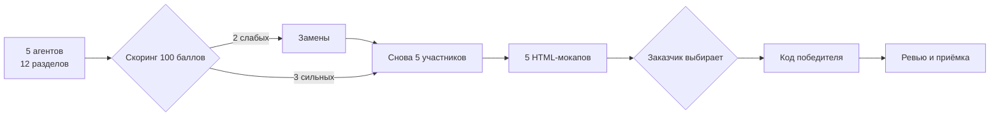

# АвтоТехСервис — сайт автосервиса

**Клиент:** «АвтоТехСервис», автосервис и шиномонтаж, Ростов-на-Дону, ул. Портовая, 439.
**Телефон:** +7 (928) 906-57-00. **Рейтинг:** 4,5 / 182 оценки (данные заказчика; карточка из нашей среды не открывается — `не проверено`).

Одностраничный сайт с прокруткой: квиз заявки (марка → VIN → неисправности), галерея фото и видео работ, отзывы, простая удалённая админка с публикацией контента с телефона. Заявки — на e-mail и в Telegram.

---

## Статус

**Этап 0 завершён и переработан 21.10.2026.** Готов конкурсный пакет: один универсальный промпт, общая структура из 12 разделов, git-протокол для агентов, рубрика на 100 баллов, сравнение вариантов реализации и CMS, фактчек с противоречиями.

**Разработка не начата и не начнётся до выбора мокапа заказчиком.**

| Этап | Что происходит | Артефакт | Статус |
|---|---|---|---|
| 0 | Бриф, промпт, рубрика, фактчек, сравнение вариантов | `docs/`, `prompts/` | ✅ |
| 1 | Пять агентов пишут концепции по 12 разделам | ветки `agent/NN-*` → `agents-output/` | ⏳ |
| 2 | Скоринг, две замены, в конкурсе остаются пять | `evaluation/round1-scorecard.md` | ⏳ |
| 3 | Пять HTML-мокапов в одном файле | `mockups/agent-NN/` | ⏳ |
| 4 | Заказчик выбирает мокап | `evaluation/decision-log.md` | ⏳ |
| 5 | Победитель пишет код, оркестратор ревьюит | `app/` | ⏳ |
| 6 | Деплой, контент, передача владельцу | `docs/` | ⏳ |

---

## Как устроен конкурс



1. Пять агентов получают **один универсальный промпт** и пишут полноценные независимые концепции. Специализация — только акцент, но все 12 разделов обязательны и оцениваются у всех.
2. Я оцениваю работы, публикую таблицу баллов, двое слабейших заменяются. **В конкурсе остаются пять полноценных участников.**
3. Все пять делают HTML-мокап в одном файле.
4. Заказчик выбирает лучший мокап. Я даю рекомендацию и риски.
5. Только после выбора — продакшн-код сильнейшим участником под моим ревью.

---

## Структура

```
prompts/
  00-universal-agent-prompt.md  — единственный промпт для всех пяти агентов
  00-context-pack.md            — факты отдельно (для замен и доп. агентов)
  README.md                     — как запустить конкурс

docs/
  00-brief.md                   — цели, аудитория, объём, KPI, DoD
  01-company-research.md        — досье компании и репутация
  02-solution-options.md        — варианты реализации, критерии, стоимость владения
  03-evaluation-rubric.md       — 12 критериев на 100 баллов
  04-orchestration-plan.md      — раунды, замены, гейты, git-протокол
  05-cms-vs-custom.md           — готовая CMS vs самописная админка (мобильная публикация)
  06-fact-check.md              — версии, источники, противоречия, что не проверено

scripts/
  import-agent.sh               — импорт ветки агента с проверками

agents-output/round1/           — импортированные концепции
mockups/                        — импортированные мокапы
evaluation/                     — скоринг, решения, проверки
```

---

## Что уже проверено, а что нет

**Проверено:** версии npm-пакетов и даты поддержки (21.10.2026), лицензии Payload (MIT), Strapi (MIT + EE), Directus (MSCL-1.0-GPL), цены Beget/Timeweb/Tilda/Strapi/Directus, наличие официальных приложений WordPress, документация Payload по загрузкам, статистика уязвимостей WordPress (по вторичным сводкам Patchstack/Wordfence).

**Не проверено:** карточка Яндекс.Карт (4,5/182 — данные заказчика), точные часы, актуальность дополнительных телефонов, год основания, гарантия, прайс, соцсети, занятость доменов, доступность приложения WordPress в российских сторах, реальная работа мобильной загрузки в каждой CMS.

Подробности и список запрещённых формулировок — `docs/06-fact-check.md`.

---

## Ключевые ограничения

- **Мобайл — основной.** 390×844 базовый, проверка от 320 px.
- **Анимация лёгкая.** `transform`/`opacity`, без scroll-jacking и 3D, `prefers-reduced-motion`.
- **Стек и палитра не зафиксированы.** Выбор — по требованиям и стоимости владения, после мокапа.
- **Никаких выдуманных фактов.** Нет данных — значит, `[уточнить]`, а не красивая цифра.
- **152-ФЗ.** Согласие, политика, хостинг в РФ, минимизация ПД в Telegram.
- **Домен `.ru`.**
