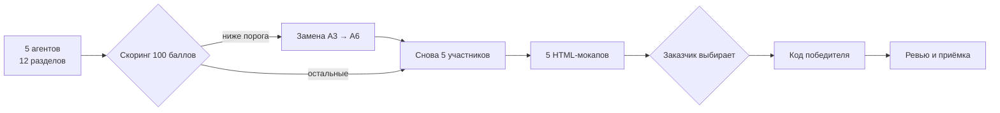

# АвтоТехСервис — сайт автосервиса

**Клиент:** «АвтоТехСервис», автосервис и шиномонтаж, Ростов-на-Дону, ул. Портовая, 439.
**Телефон:** +7 (928) 906-57-00. **Рейтинг:** 4,5 / 182 оценки (данные заказчика; карточка из нашей среды не открывается — `не проверено`).

Многостраничный сайт по структуре референса `matronet.com/demo/car-7`: главная, о компании, услуги, запись, новости, контакты. Квиз-запись (марка → VIN → неисправности), галерея фото и видео работ, отзывы, простая удалённая админка с публикацией контента с телефона. Заявки — на e-mail и в Telegram.

---

## Статус

**21.10.2026 формат изменён заказчиком.** Ему показали шаблон `https://matronet.com/demo/car-7` — сайт должен быть многостраничным и повторять его структуру. Пять одностраничных мокапов раунда 2 сняты с конкурса (результаты техприёмки сохранены в `evaluation/round2-mockups.md`), запущен **раунд 2Б**: новые мокапы, у каждого своя палитра, сильнее шрифты, анимация и форма записи. Задание — `prompts/03-template-mockups-task.md`, карта референса — `docs/08-reference-car7.md`.

**Раунд 1 закрыт 21.10.2026.** Шесть концепций получены через PR #1–#6, импортированы и оценены: **A6 — 97,8 · A5 — 89,2 · A4 — 88,2 · A2 — 88,0 · A1 — 84,4 · A3 — 70,7**. A3 заменён агентом A6 — замена удалась (97,8 против 70,7).

**Раунд 2Б закрыт 21.10.2026.** Пять многостраничных мокапов сданы и импортированы; техприёмка — `evaluation/round2b-mockups.md`. Заказчик выбрал **A5** — тёмно-зелёная тема «ночь + изумруд + медь», Unbounded + Golos Text, ветка `arena/c0d7d4ba-avtotehservis`.

**G5 пройден — разработка начата.** A5 переносит свой мокап в продакшн-код в папке `site/` по заданию `prompts/04-implementation-task.md`; A6 ревьюит по `prompts/05-review-task.md`. A1, A2, A4 из конкурса выведены, их ветки остаются архивом.

| Этап | Что происходит | Артефакт | Статус |
|---|---|---|---|
| 0 | Бриф, промпт, рубрика, фактчек, сравнение вариантов | `docs/`, `prompts/` | ✅ |
| 1 | Пять агентов пишут концепции по 12 разделам | `agents-output/round1/agent-01…06/` | ✅ (6 работ, включая замену) |
| 2 | Скоринг, замена A3 → A6, пять участников | `evaluation/round1-scorecard.md` | ✅ A6 принят: 97,8 |
| 3 | Пять одностраничных HTML-мокапов | `mockups/agent-NN/`, задание `prompts/01-mockup-task.md` | ⏸ снят с конкурса 21.10.2026 |
| 3Б | Пять многостраничных мокапов по референсу | `mockups/round2b/agent-NN/`, задание `prompts/03-template-mockups-task.md` | ✅ пять сдано, техприёмка |
| 4 | Заказчик выбирает мокап | `evaluation/round2b-mockups.md`, `evaluation/decision-log.md` | ✅ A5, 21.10.2026 |
| 5 | Внедрение: A5 пишет продакшн-код, A6 ревьюит | `site/`, `prompts/04`, `prompts/05` | ⏳ M1–M5 |
| 6 | Деплой, контент, передача владельцу | `docs/12-content-checklist.md` | ⏳ |

---

## Как устроен конкурс



1. Пять агентов получают **один универсальный промпт** и пишут полноценные независимые концепции. Специализация — только акцент, но все 12 разделов обязательны и оцениваются у всех.
2. Я оцениваю работы и публикую таблицу баллов. Порог замены — 80 баллов: ниже него оказался только A3 (70,7), он заменён на A6. Замена сдала концепцию на 97,8 — это лидер раунда; A1 (84,4) допущен с обязательными исправлениями. **В конкурсе остаются пять полноценных участников.**
3. Все пять делают HTML-мокап в одном файле.
4. Заказчик выбирает лучший мокап. Я даю рекомендацию и риски.
5. Только после выбора — продакшн-код сильнейшим участником под моим ревью.

---

## Структура

```
prompts/
  00-universal-agent-prompt.md  — единственный промпт для всех пяти агентов
  00-context-pack.md            — факты отдельно (для замен и доп. агентов)
  01-mockup-task.md             — задание раунда 2 на одностраничный мокап (снято)
  03-template-mockups-task.md   — задание раунда 2Б: многостраничный мокап по референсу
  04-implementation-task.md     — этап 4: внедрение победившего мокапа в `site/`
  05-review-task.md             — этап 5: независимое ревью (A6)
  02-replacement-task.md        — мандат агента A6 вместо A3
  README.md                     — как запустить конкурс

docs/
  00-brief.md                   — цели, аудитория, объём, KPI, DoD
  01-company-research.md        — досье компании и репутация
  02-solution-options.md        — варианты реализации, критерии, стоимость владения
  03-evaluation-rubric.md       — 12 критериев на 100 баллов
  04-orchestration-plan.md      — раунды, замены, гейты, git-протокол
  05-cms-vs-custom.md           — готовая CMS vs самописная админка (мобильная публикация)
  06-fact-check.md              — версии, источники, противоречия, что не проверено
  07-photo-brief.md             — какие фото и видео нужны по разделам сайта
  08-reference-car7.md          — разбор референса: 8 страниц, код, шрифты, палитра, дефекты формы
  09-save-reference.md          — как сохранить сайт-референс целиком (запасной способ)
  12-content-checklist.md       — что владелец заменяет после запуска: фото, тексты, доступы

scripts/
  import-agent.sh               — импорт ветки агента с проверками

agents-output/round1/           — импортированные концепции
mockups/                        — одностраничные мокапы раунда 2 (сняты)
mockups/round2b/                — многостраничные мокапы раунда 2Б; agent-05 — утверждённый дизайн
site/                           — продакшн-сайт (этап 4, в работе)
reviews/                        — отчёты независимого ревьюера
reference/                      — референс; заказчик уже выгрузил его в Google Drive (ссылка в `docs/08`)
evaluation/                     — скоринг, решения, проверки
```

---

## Что уже проверено, а что нет

**Проверено:** версии npm-пакетов и даты поддержки (21.10.2026), лицензии Payload (MIT), Strapi (MIT + EE), Directus (MSCL-1.0-GPL), версии и лицензии из концепции A6 (astro 7.4.1 MIT, @astrojs/node 11.1.9 MIT, sharp 0.35.5 Apache-2.0, better-sqlite3 13.0.3 MIT, zod 4.6.7 MIT), сайты соседей по Портовой (`autohub161.ru` — заглушка Рег.ру, `formula61.ru` — HTTP 500), цены Beget/Timeweb/Tilda/Strapi/Directus, наличие официальных приложений WordPress, документация Payload по загрузкам, статистика уязвимостей WordPress (по вторичным сводкам), **занятость доменов `.ru` через whois 21.10.2026:** `avtotehservis.ru` и `atsrostov.ru` заняты, свободны `avtotehservis439.ru`, `portovaya439.ru`, `avtoteh161.ru` и др., данные владельца (часы 9:00–19:00, ИП, e-mail, Telegram).

**Не проверено:** карточка Яндекс.Карт (4,5/182 — данные заказчика), срок и условия гарантии, актуальность дополнительных телефонов, год основания, соцсети, доступность приложения WordPress в российских сторах, реальная работа мобильной загрузки в каждой CMS. Прайса нет — цены не публикуем.

Подробности и список запрещённых формулировок — `docs/06-fact-check.md`.

---

## Ключевые ограничения

- **Мобайл — основной.** 390×844 базовый, проверка от 320 px.
- **Анимация лёгкая.** `transform`/`opacity`, без scroll-jacking и 3D, `prefers-reduced-motion`.
- **Стек и палитра не зафиксированы.** Выбор — по требованиям и стоимости владения, после мокапа.
- **Никаких выдуманных фактов.** Нет данных — значит, `[уточнить]`, а не красивая цифра.
- **152-ФЗ.** Согласие, политика, хостинг в РФ, минимизация ПД в Telegram.
- **Домен `.ru`.**

---

## Приложение. Раунд 12 — переработка первого экрана и фото

Задание: `prompts/17-task-round12-hero-rework.md`. Жалобы заказчика: фото героя обрезано и
машины «не туда», заголовки слайдов 2–3 не на своём месте, полоса из трёх новых фото, фото
«О компании» без машин в проёмах, некрасивый фон панели диагностики, одинаковые бейджи услуг.
Ветка-исполнитель: `arena/c0d7d4ba-avtotehservis` (агент 5).

### Что сделано

1. **§2 компоновка героя.** Три режима: ≥1024 — две колонки (текст слева на `--night` без
   подложек, фото справа **целиком** в рамке 16:9 с радиусом 26 px, кантом
   `rgba(224,169,109,.18)` и тенью `0 30px 80px rgba(0,0,0,.55)`); 641–1023 — фото сверху
   целиком во всю ширину, текст ниже без подложки; ≤640 — панель текста `rgba(6,11,9,.82)`
   как была. Левый край H1 = левый край логотипа шапки (`--cx`); центр текста 50 % высоты героя
   (норма 46–54); карусельные контролы стоят в потоке под фото, пересечение с кнопками = 0 px².
2. **§2 целиком = без кропа на всех слайдах.** Рамка 16:9; слайд 1 был 16:9, а слайды 2–3 —
   2048×1143 (1.7918) и теряли ~0,8 % ширины под `object-fit:cover`. Патч #62 сборщика:
   центральный кроп исходников до 2032×1143 = ровно 16:9, наборы 640×360…2032×1143,
   кроп 0.00 px на всех ширинах (проверяет `check-hero-layout.mjs` по файлам).
3. **§3 мастер.** Зоны по яркости: вывеска 0…37.8 % (норма ≤38±3), машины 57.6…96.0 %
   (норма 46…96±3 — **отклонение**, см. ниже), асфальт 4.0 % (≤4±3). Нос-к-носу, ДХО пик 255
   (норма ≥235) с ореолом и световыми дорожками, контактная тень 0.58 (≤0.6), ΔE теней 2.54
   (≤6), «не куски»: зерно 0.9 % (≤20), резкость 15.6 % (≤25), шов простенков — структурная
   ступень 0 (остаток 4.47 — шум jpeg-оценщика, **отклонение** по формальному порогу ≤3).
4. **§5 полоса.** Три кадра из `r11-gen` (tyre→lift→diag), 1200×500, avif+webp
   20.4/22.8/16.5 и 38.3/32.2/24.9 КБ (лимит 60), подписи и alt по факту содержимого.
5. **§6 «О компании».** Кроп 1600×1000 (окно {600,250,2560×1600} из wide-исходника): оба проёма
   целиком, в проёмах **другие** машины (седан на подъёмнике из `r12-gen/bay-sedan.jpg`,
   кроссовер с размытой эмблемой из `bay-crossover.jpg`), тон вставок согласован с фасадом,
   перо 64/48 px — граница вставки ΔE76 5.45/4.91 к фасаду в 6-px полосе (норма ≤6),
   вес 66.2 КБ (≤70). Проверка: `check-about-panel.mjs` (сравнивает финал с фасадом без вставок
   и с исходниками вставок).
6. **§7 панель диагностики.** Фон `cta-diag` 960×540/640×360, дим градиентом .78→.86 цвета
   (11,20,16) **поверх предзатемнённого** источника (×0.45 в сборщике): контраст h3 brass
   7.19:1 и p mist 8.31:1 по худшему пикселю (норма ≥7). Читаемых фрагментов нет: ярких тонких
   штрихов 0.0147 % пикселей, максимум яркости 122, вес 8.3/3.9 КБ (≤45).
7. **§8 бейджи и карусель.** На главной три карточки услуг — «Колёса», «Ремонт и ТО»,
   «Диагностика» (представители групп первыми в `listHomeServices`); стрелки/точки — карусельные
   контролы в потоке под фото. Вернул лайтбокс в `Base.astro` и `lint-css-order.mjs`, которые
   потерял squash-main.

### Измерения и автопроверки

`npm test` в `site/` = `astro build` + 64 модульных/e2e-теста + `check-safe-zone.mjs`
(9 десктоп- и 6 мобильных вьюпортов: кадр целиком, название в кадре, машины не пересекают
текст) + `check-hero-layout.mjs` (геометрия ≥1024 по формулам CSS на 9 ширинах, режимы
641–1023 и ≤640, пропорции файлов всех слайдов, веса полосы/панели) + `measure-contrast.mjs`
(текст героя в трёх режимах и панель диагностики по худшему пикселю фона) + `check-about-panel.mjs`
(содержимое §6–§7). Отдельно `npm run smoke` (14 проверок живого сервера, лид-формы не трогает).

### Отклонения (измерены, не «на глаз»)

- **Верх машин 57.6 % вместо 46 %** (§3): в кадре 16:9 две цельные машины родных пропорций
  занимают по высоте ~50 % каждая; уместить их в полосу 46…96 % без кропа или растяжения
  геометрически невозможно. Выбрано «целиком», как требует §2.
- **Шов 4.47 при пороге ≤3** (§3): структурная ступень на границе вставки простенков = 0;
  остаток — шум jpeg-оценщика на фактуре кирпича (проверено на паре идентичных областей).
- **Скриншотов браузера нет**: в песочнице отсутствует chromium/playwright-браузер, поэтому §2
  проверен аналитически (формулы CSS, пропорции файлов, порядок DOM) и по собранным файлам,
  а не рендером. Геометрия сходится с живой разметкой (проверено curl по собранному HTML).

### Как воспроизвести

```
cd site && npm ci
node scripts/build-images.mjs        # все растры public/img + safe-zone-geom.json + таблица весов
npm run build && DATA_DIR=<каталог> npm run migrate && DATA_DIR=<каталог> npm run seed
npm test                             # сборка + тесты + 4 проверки фото/компоновки/контраста
DATA_DIR=<каталог> HOST=0.0.0.0 PORT=4321 node ./dist/server/entry.mjs && npm run smoke
```

Исходники фото и промежуточные проходы — `docs/photos-source/` (веса и лимиты в его README
генерируются сборщиком); референсы заказчика раунда 12 — `docs/art-direction/client-r12/`.
