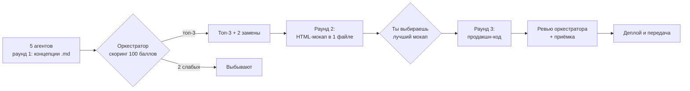

# АвтоТехСервис — сайт автосервиса

**Клиент:** «АвтоТехСервис», автосервис + шиномонтаж
**Адрес:** Ростов-на-Дону, ул. Портовая, 439
**Телефон:** +7 (928) 906-57-00
**Рейтинг:** 4,5 / 182 оценки (Яндекс.Карты)

Одностраничный сайт с прокруткой: квиз заявки на ремонт (марка → VIN → неисправности), галерея фото/видео работ, отзывы, простая удалённая админка, заявки на e-mail + дубль в Telegram.

---

## Где мы сейчас

**Этап 0 — подготовка.** Проведено исследование компании, написан бриф, выбрано техническое направление, подготовлены 5 промптов для агентов и рубрика оценки. Продакшн-код пока не пишется — по плану он появится только после выбора лучшего HTML-мокапа.

| Этап | Что происходит | Артефакт | Статус |
|---|---|---|---|
| 0 | Исследование, бриф, промпты | `docs/`, `prompts/` | ✅ готово |
| 1 | 5 агентов предлагают концепции | `agents-output/round1/agent-0X-*.md` | ⏳ ждёт тебя |
| 2 | Оркестратор оценивает, оставляет 3 из 5 | `evaluation/round1-scorecard.md` | ⏳ |
| 3 | Финалисты делают HTML-мокап в 1 файле | `mockups/agent-0X.html` | ⏳ |
| 4 | Ты выбираешь мокап | `evaluation/decision-log.md` | ⏳ |
| 5 | Победитель пишет продакшн-код, оркестратор ревьюит | `app/` | ⏳ |
| 6 | Деплой, контент, передача владельцу | `docs/08-launch.md` | ⏳ |

---

## Структура репозитория

```
docs/
  00-brief.md              — бриф: цели, аудитория, объём работ, KPI, ограничения
  01-company-research.md   — досье компании: факты, источники, репутация, конкуренты
  02-tech-direction.md     — рекомендованный стек, архитектура, интеграции, деплой
  03-evaluation-rubric.md  — как я оцениваю агентов (100 баллов + стоп-фильтры)
  04-orchestration-plan.md — полный план раундов, роли, таймлайн, что нужно от тебя

prompts/
  README.md                — как запускать агентов (читать первым)
  00-context-pack.md       — общий контекст-пакет (источник правды по фактам)
  01-brand-strategist.md   — промпт агенту №1: бренд, нейминг, домен .ru, логотип
  02-art-director.md       — промпт агенту №2: визуал, анимация, мобильный дизайн
  03-ux-cro-architect.md   — промпт агенту №3: структура, квиз, конверсия
  04-tech-architect.md     — промпт агенту №4: стек, админка, интеграции, перф
  05-copy-content.md       — промпт агенту №5: тексты, кейсы, отзывы, контент-план
  06-round2-mockup.md      — задание раунда 2 (HTML-мокап в одном файле)

agents-output/round1/      — сюда кладём .md от агентов (имена файлов в README папки)
mockups/                   — сюда кладём HTML-мокапы финалистов
evaluation/                — оценки, скоринг, решение по победителю
```

---

## Процесс



---

## Что сделать прямо сейчас

1. Открой `prompts/README.md` — там порядок запуска.
2. Скопируй пять промптов в пять отдельных агентов на Арене.
3. Сложи их ответы в `agents-output/round1/` под именами из README папки.
4. Вернись сюда — я оценю по рубрике, покажу таблицу баллов и разберу, кто выбыл и почему.

> Важно: все агенты получают одинаковый набор фактов и одинаковый формат ответа. Это делает сравнение честным, а не «кто красивее написал».

---

## Ключевые ограничения проекта

- **Мобайл — основной.** 70–85% трафика, первый экран проектируем под 390×844.
- **Анимация лёгкая.** Только `transform`/`opacity`, без scroll-jacking, без WebGL/3D, `prefers-reduced-motion` уважается.
- **Никаких выдуманных фактов.** Года работы, сертификатов, цен «от» и количества постов не существует в открытых данных — значит, их нельзя придумывать.
- **152-ФЗ.** Согласие на обработку ПД, политика, хостинг в РФ, минимизация данных в Telegram-уведомлении.
- **Домен — .ru.** Нейминг и проверка домена входят в задачу агента №1.
