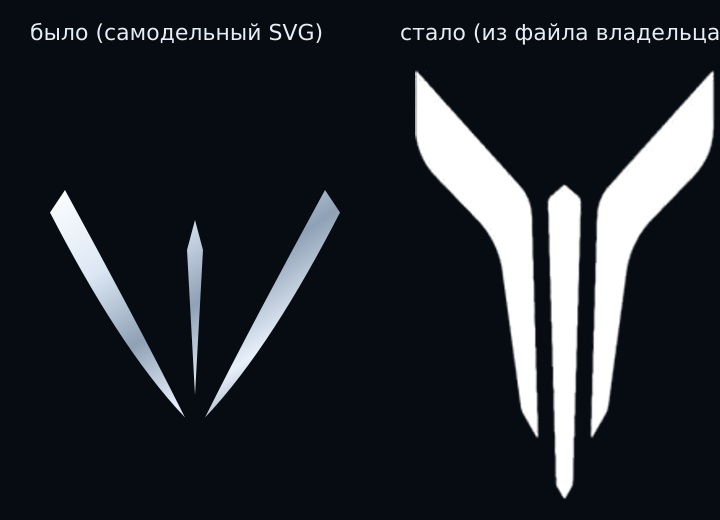

# Круг 30 — отчёт: знак марки, заставка, дальше 3D агентами

**Дата:** 21.10.2026 · **Ветка:** `arena/099a14c5-avtotehservis` · **Коммиты:** `3617be2`, `1eb2dbb`
**Публикация превью:** `preview/github-pages` → `a5c8f34`, GitHub Action run `42764481111` — success.

---

## 1. Знак Voyah — было / стало

Слева — то, что стояло: самодельные «три палочки» (клинки, нарисованные на глаз).
Справа — **настоящий знак из присланного файла**: две изогнутые лопасти и центральная
игла с огранённым наконечником. Сборка автоматическая (`site/scripts/build-voyah-logo.mjs`),
исходники лежат в `docs/brand/voyah/source/`.

Что появилось:

| Файл | Размер | Где используется |
|---|---|---|
| `site/public/img/vy-mark.png` | 512×733, 43 КБ | страница (первый экран, прайс, CTA, тизер), кадры машин |
| `site/public/img/vy-mark@2x.png` | 256 px, 13 КБ | мелкие размеры 24–30 px |
| `site/public/img/vy-label.png` | 960×133 | надпись VOYAH |
| `site/public/img/vy-lockup.png` | 1200×587 | знак + надпись одним файлом |
| `site/public/img/vy-mark-ghost.png` | 360 px | водяные знаки на фонах секций |

Самодельные `vy-mark.svg` и `vy-mark-ghost.svg` **удалены**, чтобы «три палочки» больше
никогда не вернулись. Знак на кадрах машин теперь тоже настоящий (проверено кропом решётки
на `voyah-evening-mark.jpg` — знак стоит по центру, лопасти и игла читаются).

Скриншоты текущего состояния: `docs/reports/r30-current/03-hero-1440.png` (первый экран),
`04-mark-eyebrow.png` (знак в «надбровной» строке), `05-mark-price-panel.png` (панель прайса).

### 1.1. Правка по замечанию владельца: знак на машине — на решётке

Владелец прислал скрин: «на машине промахнулся со значком, она на решётке радиатора».
Верно — на первом экране знак стоял на хромированной полосе под фарой, на 5 px выше ламелей.

Замер по мастеру `hero.jpg` (яркостная карта): ламели — строки 292…322, осевая линия
кузова проходит через центр номерного знака (x = 774). Знак перенесён на 765/296 (18×25) —
по центру решётки, в ламели, как на референсе `docs/brand/voyah/source/grille-badge-lit.jpg`.
На вечернем кадре знак увеличен по нише: щит на решётке по замеру 498…532 × 421…468,
знак 28×41 внутри щита (было 22×32 — мелкая наклейка в верхней трети).

Скриншот после правки: `docs/reports/r30-current/08-hero-1440.png`, кроп машины —
`09-hero-car-crop.png`, скриншот владельца «до» — `07-owner-shot-mark.png`.

## 2. Заставка — теперь на каждый заход

Причина, по которой владелец видел анимацию «один раз и больше не загружается»:
`sessionStorage`-флаг гасил её до конца сессии. Флаг убран, теперь при каждом входе
на раздел сцена проигрывается. `?intro=0` — выключить, `?intro=1` — оставить.
Гейт `check-voyah-layout` переписан под новое правило: если на повторном заходе заставки
нет — гейт падает (проверено `--self-test`, 4/4).

Замеры после правок: десктоп 2391 мс (норма ≤2500), мобайл 390 — 1349 мс, 360 — 1348 мс.

## 3. 3D — разбор и агенты

**Коротко:** SVG-заставка плоская по своей природе, «улучшать» её бессмысленно. Настоящий
3D = WebGL2. Свой шейдер — 12–25 КБ gzip; three.js — 409 КБ gzip (проверено на 0.187), для
2,5-секундной анимации это неприемлемо. WebGL2 в нашем тестовом браузере работает,
значит кадры-доказательства можно снимать автоматически.

Полный разбор: **`docs/reports/r30-plan.md`** (включая рамки 3D-фона: 0,5× разрешение,
пауза вне вьюпорта, автоотключение, бюджеты и что именно ломается).

Промпты агентам:

| Файл | Агент | Задача |
|---|---|---|
| `prompts/43-task-r30-intro-3d.md` | A-INTRO-3D | заставка: 3 концепта настоящего 3D (неоновый каркас / сборка знака / ночь→бокс) |
| `prompts/44-task-r30-bg-3d.md` | A-BG-3D | 3D-фон: два варианта + замеры fps/батареи/памяти и честный вердикт |
| `prompts/45-task-r30-logo-vector.md` | A-LOGO-VECTOR | вектор знака (ошибка ≤1,5 px) + `paths.json` для экструзии в 3D |
| `prompts/46-task-r30-review-3d.md` | A-REVIEW-3D | независимая приёмка всех трёх работ |

**Кто именно из наших агентов:** A5 (заставка, существующий), A10 (фон, новый),
A11 (вектор знака, новый), A6 (приёмка, существующий). Состав, обоснование и готовые
сообщения для пересылки — `prompts/47-r30-agent-roster.md`.

## 4. Проверки

- `LD_LIBRARY_PATH=/tmp/al2023/lib npm test` — **79/79, rc=0**
- `check-voyah-layout` — всё в норме; `--self-test` 4/4
- `measure-contrast` — все нормы; `check-voyah-content` — чисто
- `npm run build`, `npm run build:pages` — ok; публикация превью — success

## 5. Открытый вопрос

Задание №42 (повторная приёмка круга 29) у ревьюера — вердикта пока нет.
